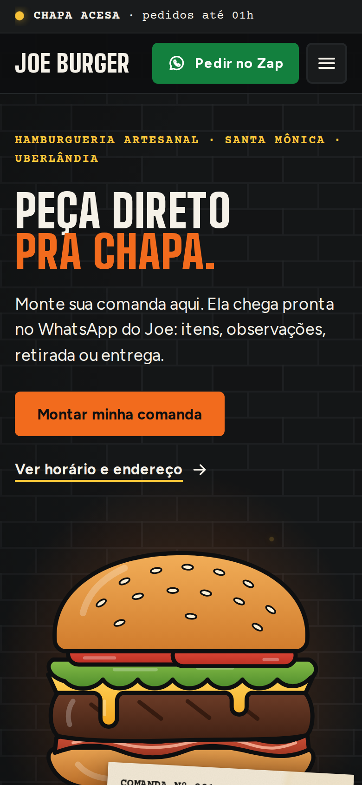
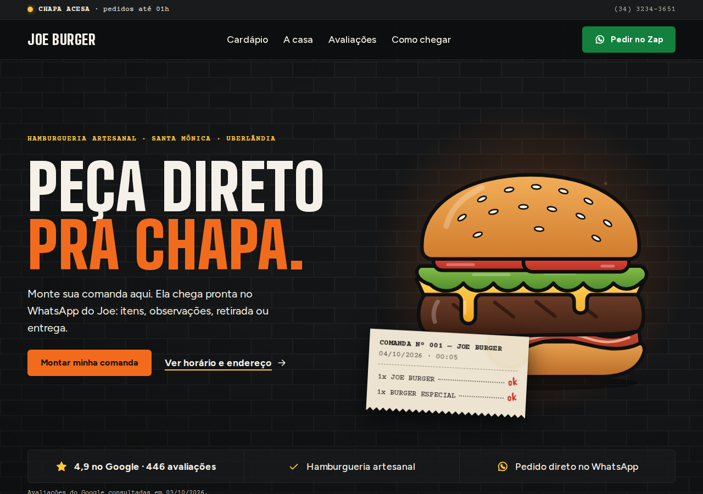
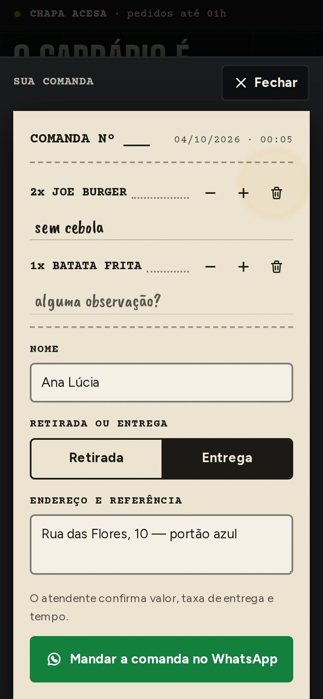
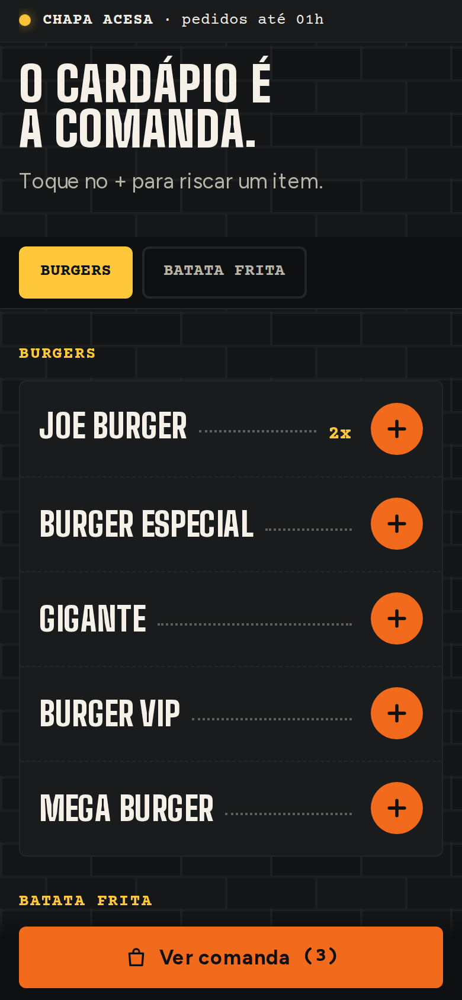
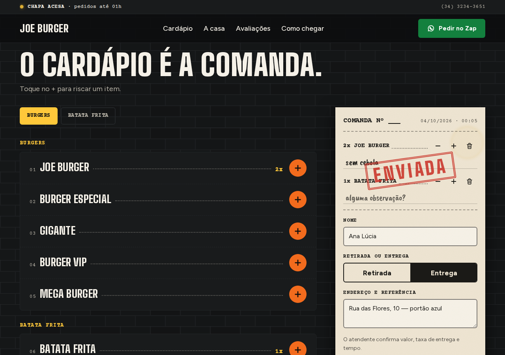
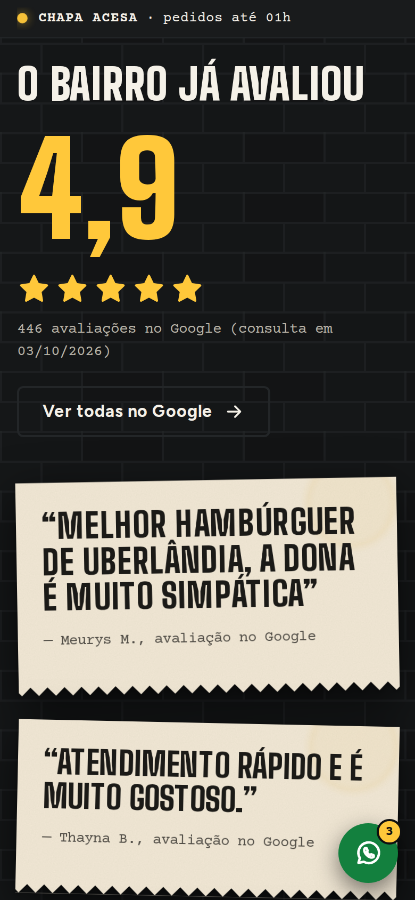
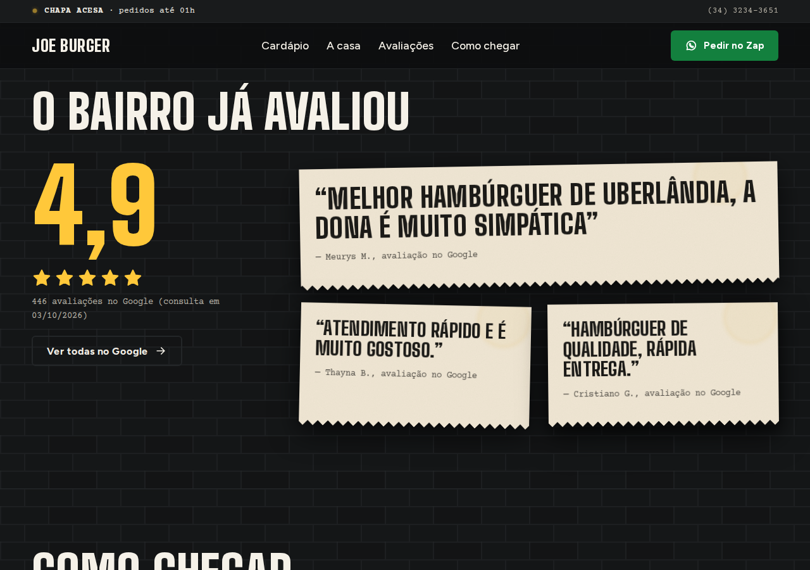

# Relatório — prévia do site Joe Burger Artesanal ("A Comanda")

Data: 04/10/2026.

## (a) O que foi feito

Site de uma página (`/` + `/robots.txt` + `/sitemap.xml` + imagem de compartilhamento), Next.js 16 App Router,
TypeScript, CSS Modules, fontes via `next/font/google`, sem biblioteca de animação.

- **Barra de status** fixa: "CHAPA ACESA · pedidos até 00h/01h", "CHAPA APAGADA · acende hoje/amanhã às 18h",
  "A CHAPA DESCANSA HOJE · volta terça às 18h". Calculada no servidor no momento do request (sai certa no HTML)
  e atualizada a cada 30 s no cliente, no fuso America/Sao_Paulo. Janelas que passam da meia-noite pertencem ao
  dia em que começam.
- **Hero** com hambúrguer em SVG desenhado no código (7 camadas, contorno grosso, um degradê por camada),
  halo de brasa, 5 faíscas e a comanda decorativa com a hora do Brasil e os 2 primeiros itens do `menu.json`.
- **Como funciona**: 3 papeizinhos presos por clipe.
- **Cardápio = comanda**: abas por categoria (fixas no celular), linhas com pontilhado até a quantidade,
  botão "+" de 44 px. Painel da comanda em coluna fixa no desktop e bottom sheet no celular/tablet
  (foco preso, Esc fecha). Observação por linha, nome, retirada/entrega, endereço só na entrega, validação
  inline em vermelho carimbo com foco no primeiro campo inválido, carimbo "ENVIADA" e abertura do WhatsApp
  com a mensagem no formato combinado. Se o navegador bloquear a nova aba, aparece o link "Abrir WhatsApp".
  A comanda fica salva no aparelho (localStorage) e tem "Limpar comanda".
- **A casa**: o mesmo hambúrguer desmontado, com legendas à mão (pão, salada, queijo, carne).
- **Avaliações**: 4,9 + estrelas (a 5ª preenchida em 90%) + 446 avaliações com a data da consulta e as 3
  avaliações reais com crédito. Sem `aggregateRating`/`review` no JSON-LD.
- **Como chegar**: cartão de endereço com "Abrir no Maps" (sem iframe), tabela de horários com o dia de hoje
  em mostarda, botões de WhatsApp, ligar e Instagram (iFood só aparece com `IFOOD_URL`).
- **CTA final** que muda o texto quando a chapa está apagada, com um hambúrguer em estilo carimbo à direita
  (desktop). **Rodapé** com endereço, horários resumidos e "Site por Webcreate" (sem link).
- **Botão flutuante** de WhatsApp no celular depois do hero, com selo de quantidade; com itens, abre a comanda.
  Os botões "Pedir no Zap"/"Chamar no Zap" mandam a mensagem simples quando a comanda está vazia e abrem a
  comanda quando há itens (a mensagem da comanda só sai pelo painel).
- **SEO**: título e descrição (134 caracteres) pedidos, Open Graph/Twitter com imagem 1200×630 gerada por
  `next/og`, JSON-LD `Restaurant` com horários (sex/sáb fechando 01:00). Sem canonical e sitemap sem host
  enquanto `SITE_URL` estiver vazio.
- Tudo que depende da dona está em `lib/config.ts` e `data/menu.json` (ver README).

### Protocolo de QA (resultado)

| # | Verificação | Resultado |
| --- | --- | --- |
| 1 | `next build` sem erro nem aviso de tipo; testes do horário | ok — 15/15 testes verdes: todos os casos pedidos, mais "amanhã", folga no meio da semana, fuso, textos derivados e a mensagem do WhatsApp |
| 2 | 360, 390, 768, 1280 px, página inteira | ok — sem rolagem horizontal, H1 inteiro, nenhuma caixa vazia (imagens abertas e revisadas) |
| 3 | Fluxo da comanda por script | ok — URL `https://wa.me/553432343651?text=…`, texto decodificado idêntico ao formato, `\n` e acentos íntegros; entrega sem endereço bloqueia com erro inline |
| 4 | Sem JavaScript | ok — todas as seções legíveis, hambúrguer montado, menu do celular vira linha de links |
| 5 | `prefers-reduced-motion` | ok — 0 animações rodando; ao adicionar item, só fade de 120 ms |
| 6 | Teclado | ok — 32 paradas (desktop) / 27 (celular), todas com anel mostarda de 3 px; bottom sheet com foco preso e Esc |
| 7 | Lighthouse celular (mediana de 3) | Performance **97**, Acessibilidade **100**, Boas práticas **100**, SEO **100** — LCP 2,4 s, TBT 46 ms, CLS 0. Desktop: 100/100/100/100 |
| 8 | Console, 404, fotos do Instagram no bundle | ok — console limpo (produção e dev), nenhuma requisição quebrada, nenhum "instagram-" em `.next`/`public` |
| 9 | Palavras proibidas | ok — "R$", "Lorem", "A CONFIRMAR", "FOTO", "inigual": 0; "melhor" só dentro da citação da Meurys M. |

### Desvios e observações

- **Logo**: o repositório chegou vazio, sem `public/brand/logo-joe.png` nem `refs/`, e a rede deste ambiente
  bloqueia o Instagram. O site está pronto para o arquivo: header, rodapé, favicon, imagem de compartilhamento e
  JSON-LD passam a usar o logo assim que ele for colocado em `public/brand/logo-joe.png`. Testei com um arquivo
  provisório de 135×130 (não publicado). Até lá, o header mostra "JOE BURGER" em texto e o favicon é um
  hambúrguer simples. No celular estreito (< 420 px), com o logo presente, fica só o logo + botão + menu.
- **Deploy**: a rede deste ambiente bloqueia `vercel.com`, então não publiquei a URL. Basta importar o
  repositório na Vercel (zero configuração).
- **JS da página**: 146 KB gzip, acima da meta de 120 KB. O piso do Next 16 App Router + React 19 sozinho é de
  ~130 KB gzip (testado com Turbopack e webpack); o código do site é ~15 KB. A performance mesmo assim fica
  em 97 no celular. Para chegar em 120 KB seria preciso trocar de stack.
- **Fonte**: no Google Fonts a "Big Shoulders Display" virou o eixo `opsz` da família "Big Shoulders". Usei a
  família com esse eixo: nos tamanhos grandes ela é o corte Display. Figtree e Big Shoulders são variáveis
  (1 arquivo cada); Courier Prime 400/700; Caveat Brush 400.
- **Indexação**: o site sai indexável (SEO 100). Se preferir que a prévia não apareça no Google antes do aceite
  da dona, dá para marcar `noindex` até lá (isso derruba a nota de SEO do Lighthouse, por definição).

## (b) Pendências da dona

- Cardápio real com descrições (hoje: nomes das artes do Instagram, marcados como exemplo).
- Preços (decidir se aparecem; o site hoje não mostra preço em lugar nenhum).
- Fotos reais dos lanches.
- Logo original em alta resolução.
- Confirmação dos horários (18h no Google Maps × 19h no Instagram).
- Link do iFood.
- Autorização para citar as 3 avaliações.
- Confirmação de "negócio de família".
- Domínio.

## (c) Screenshots

| | 390 px | 1280 px |
| --- | --- | --- |
| Hero |  |  |
| Comanda |   |  |
| Avaliações |  |  |
